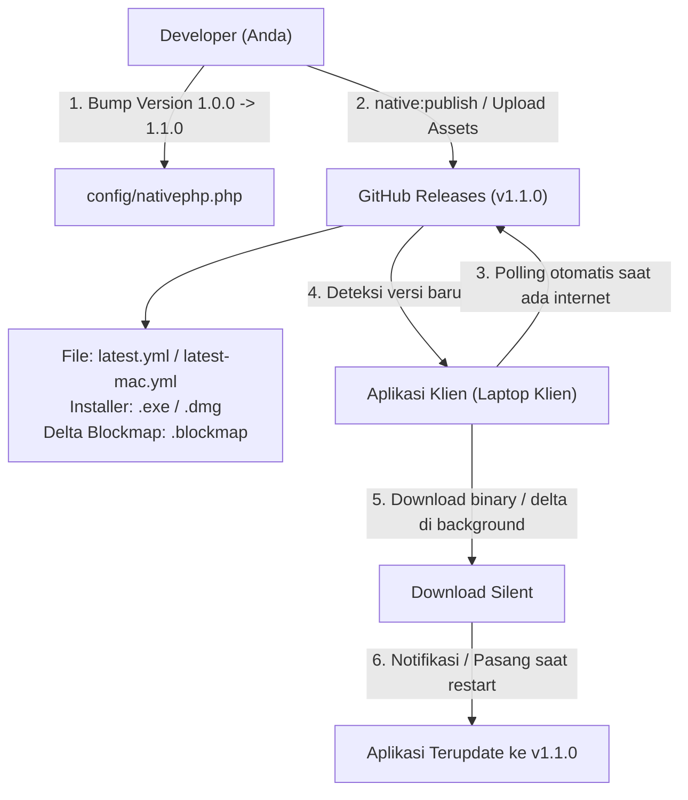

# Panduan Desktop App NativePHP & GitHub Releases Auto-Update

Dokumen ini menjelaskan implementasi desktop application untuk **Web Psikolog — Clinical Practice & Records** menggunakan **NativePHP**, serta mekanisme distribusi dan pembaruan versi otomatis (**Auto-Update**) melalui GitHub Releases.

---

## 1. Status Konfigurasi NativePHP

### A. Window Configuration
File: [`app/Providers/NativeAppServiceProvider.php`](file:///Users/m.zulkarnaen/Documents/MZulkarnaen/web/web-psikolog/app/Providers/NativeAppServiceProvider.php)
- **Judul Window:** `Web Psikolog — Clinical Practice & Records`
- **Dimensi Default:** `1366 x 860` px
- **Dimensi Minimum:** `1024 x 700` px
- **Background Color:** `#080f14` (Dark Sanctuary theme konsisten, mencegah white-flash saat booting)
- **Window State Memory:** `rememberState()` aktif (posisi dan ukuran terakhir otomatis disimpan saat aplikasi dibuka kembali)
- **DevTools:** Dinonaktifkan (`showDevTools(false)`) untuk kenyamanan user akhir
- **PHP INI Directives:**
  - `memory_limit: 512M` (optimal untuk export rekap PDF DomPDF berukuran besar dan database backup zip)
  - `max_execution_time: 120` detik

### B. Metadata & Updater Defaults
File: [`config/nativephp.php`](file:///Users/m.zulkarnaen/Documents/MZulkarnaen/web/web-psikolog/config/nativephp.php)
- **App ID:** `com.webpsikolog.app`
- **Author:** `Basirah, M.Psi., Psikolog`
- **Copyright:** `© 2026 Web Psikolog. All rights reserved.`
- **Default Updater Provider:** `github`
- **Target Repo:** `magerngulik/web-psikolog`

---

## 2. Cara Menjalankan Aplikasi di Mode Desktop (Development)

Untuk menjalankan aplikasi dalam mode desktop development:

```bash
# Opsi 1: Menjalankan Vite hot-reload + Desktop Window bersamaan (Direkomendasikan)
composer run native:dev

# Opsi 2: Menjalankan native app server saja
php artisan native:run
```

Aplikasi Electron akan muncul dengan tampilan desktop mandiri, terhubung langsung ke SQLite database lokal.

---

## 3. Cara Membangun Installer (Production Build)

Installer yang dihasilkan sudah memaketkan runtime PHP, server internal, database SQLite, dan seluruh asset UI. Pengguna (klien) **TIDAK PERLU** menginstal Node.js, PHP, Composer, ataupun Git di komputer mereka.

```bash
# Build untuk macOS (.dmg dan .zip)
php artisan native:build mac

# Build untuk Windows (.exe installer NSIS)
php artisan native:build win

# Build untuk Linux (.AppImage / .deb)
php artisan native:build linux
```

File installer akan tersimpan di folder `dist/` (sudah dimasukkan ke `.gitignore` agar tidak mengotori repository git).

---

## 4. Mekanisme Auto-Update Melalui GitHub Releases

NativePHP menggunakan **`electron-updater`** di bawah naungan Electron. Mekanisme ini adalah standar industri yang juga dipakai oleh aplikasi seperti VS Code, Discord, dan Slack.



### Komponen File Release
Setiap rilis di GitHub Releases menghasilkan:
1. **File Binary:** Contohnya `Web Psikolog Setup 1.1.0.exe` (Windows) atau `Web Psikolog-1.1.0.dmg` (macOS).
2. **File Manifest Versi (`latest.yml` / `latest-mac.yml`):** Berisi info hash SHA-512, tanggal rilis, dan nomor versi terbaru. File inilah yang dibaca oleh aplikasi klien untuk mengetahui ada tidaknya versi baru.
3. **File Blockmap (`.blockmap`):** Digunakan untuk **differential / delta update** sehingga klien hanya men-download perbedaan file saja, bukan mendownload ulang installer utuh ratusan megabyte.

---

## 5. Tutorial Langkah-demi-Langkah Rilis Versi Baru

### Langkah 1: Naikkan Versi Aplikasi
Di [`config/nativephp.php`](file:///Users/m.zulkarnaen/Documents/MZulkarnaen/web/web-psikolog/config/nativephp.php) (atau file `.env`):
```php
'version' => env('NATIVEPHP_APP_VERSION', '1.1.0'),
```

### Langkah 2: Commit dan Push Perubahan ke GitHub
```bash
git add .
git commit -m "feat: release version 1.1.0"
git push origin main
```

### Langkah 3: Siapkan GitHub Personal Access Token (PAT)
Untuk mengizinkan perintah build mengunggah otomatis ke GitHub Releases:
1. Buka akun GitHub: **Settings > Developer Settings > Personal Access Tokens > Tokens (classic)**.
2. Buat token baru dengan scope **`repo`** (Read & Write repository releases).
3. Salin token tersebut.

### Langkah 4: Publikasikan Rilis
Jalankan perintah publish dengan menyertakan token:

```bash
# Untuk macOS:
GITHUB_TOKEN=ghp_token_anda_disini php artisan native:publish mac

# Untuk Windows:
GITHUB_TOKEN=ghp_token_anda_disini php artisan native:publish win
```

Perintah di atas akan otomatis:
1. Meng-compile seluruh kode dan asset aplikasi ke versi `1.1.0`.
2. Membuat Release Tag `v1.1.0` di repository GitHub `magerngulik/web-psikolog`.
3. Mengunggah file installer (`.dmg` / `.exe`), file `.blockmap`, dan file `latest.yml` / `latest-mac.yml` ke rilis tersebut.
4. Menyetel status rilis (secara default rilis dibuat sebagai draft atau published sesuai konfigurasi `releaseType`).

---

## 6. Apa yang Terjadi pada Laptop Klien?

1. **Ketika Offline:**
   - Klien tetap bisa menggunakan aplikasi 100% tanpa hambatan. Tidak ada error pop-up yang mengganggu.
2. **Ketika Online (Tersambung Internet):**
   - Saat aplikasi dibuka, background worker `electron-updater` mengecek URL:
     `https://api.github.com/repos/magerngulik/web-psikolog/releases/latest`
   - Klien membandingkan versi lokal (`1.0.0`) dengan versi di GitHub (`1.1.0`).
   - Jika versi di GitHub lebih tinggi, paket update di-download di background.
   - Saat download selesai, aplikasi siap beralih ke versi baru pada restart berikutnya secara mulus.

> [!NOTE]
> **Jika Repository GitHub Bersifat Privat (Private Repo):**
> Klien memerlukan read-only token untuk mengunduh release asset. Hal ini diatur melalui variabel `GITHUB_AUTOUPDATE_TOKEN` di `config/nativephp.php`. Jika repository Anda bersifat **Public**, auto-update bekerja langsung tanpa token apapun di sisi klien.
